# Spesifikasi Dokumentasi Papan Miro (*Miro Documentation Specification*)
Museum Virtual Universitas Diponegoro (Versi 1.0)

Dokumen ini merupakan cetak biru spesifikasi dokumentasi proyek Museum Virtual Universitas Diponegoro (Undip) yang dipetakan secara terstruktur untuk papan Miro resmi proyek:
🔗 **Papan Miro Proyek**: [Museum Virtual Undip di Miro](https://miro.com/app/board/uXjVEN0vw2Y=/?share_link_id=923640810152)

Dokumen ini dirancang agar para pemangku kepentingan (*stakeholders*), pimpinan universitas, pengembang perangkat lunak, dan penjamin mutu (*QA*) memiliki pemahaman yang selaras mengenai visi, ruang lingkup, arsitektur, dan alur proyek.

---

## 1. Ikhtisar Eksekutif Proyek (*Project Overview*)

* **Nama Proyek**: Museum Virtual 3D Universitas Diponegoro
* **Visi**: Menyajikan wahana penjelajahan sejarah, capaian riset, dan profil kepemimpinan Undip secara imersif, interaktif, dan modern dalam bentuk diorama 3D berbasis peramban web (*web-based virtual museum*) yang ramah pengguna dan aksesibel bagi penyandang disabilitas.
* **Tujuan Strategis**:
  1. Melestarikan dan memublikasikan warisan sejarah serta profil rektor Undip kepada generasi muda melalui medium digital 3D.
  2. Memberikan pengalaman interaktif langsung menggunakan karakter avatar orang ketiga (*third-person view*) yang dapat diakses dari mana saja tanpa perlu mengunduh aplikasi terpisah.
  3. Memastikan standar kebahasaan Indonesia yang luhur dan baku sesuai kaidah KBBI dan PUEBI/EYD V.
  4. Menjaga ketahanan infrastruktur peladen (*server*) kampus agar tetap stabil meskipun diakses oleh ribuan pengunjung serentak.

---

## 2. Target Audiens (*Target Audiences*)

1. **Mahasiswa Baru & Sivitas Akademika Undip**: Sarana pengenalan sejarah almamater (*onboarding* kampus) dan nilai-nilai luhur Pangeran Diponegoro.
2. **Calon Mahasiswa & Pelajar Sekolah**: Media edukasi dan promosi kampus untuk melihat fasilitas riset dan kemegahan gedung Muladi Dome.
3. **Alumni Universitas Diponegoro**: Sarana nostalgia dan melihat rekam jejak kepemimpinan serta transformasi Undip dari masa ke masa.
4. **Masyarakat Umum & Wisatawan Virtual**: Pengunjung daring yang ingin menikmati tur museum sejarah secara gratis dan interaktif.
5. **Pengguna Berkebutuhan Khusus (*Special Needs / Low Vision*)**: Difasilitasi dengan tombol narator suara otomatis (*Text-to-Speech*) berbahasa Indonesia alami pada setiap etalase sejarah.

---

## 3. Ruang Lingkup Pengembangan (*Project Scope*)

### A. Termasuk dalam Lingkup (*In-Scope*)
* Penjelajahan diorama 3D sudut pandang orang ketiga (*third-person perspective*) dengan avatar modular bergaya *Roblox*.
* Simulasi fisika rigid body dan tabrakan dinding akurat berbasis *WebAssembly* (`@react-three/rapier`).
* Penataan 3 Zona Utama dengan fokus Zona 1 memiliki 5 pintu portal sub-bab sejarah.
* Arsitektur pemuatan dinamis (*Dynamic Room Loading*): hanya me-mount ruangan sub-bab aktif guna menjaga stabilitas memori VRAM.
* Layar sambutan pembuka (*Splash Gate*) dengan tombol interaktif untuk membuka kunci kebijakan *autoplay audio* peramban, memutar musik latar belakang (*BGM*), dan memicu *onboarding guide tour*.
* Bilah sisi (*sidebar*) untuk alih zona instan dan bilah bawah (*bottom bar*) untuk petunjuk arah interaktif.
* Transisi kamera sinematik halus (*lerp focus*) dan efek suara (*SFX whoosh/chime*) saat berinteraksi dengan bingkai foto.
* Pengaturan tingkatan grafis adaptif (*Rendah, Normal, Tinggi*) yang memisahkan komponen Primer, Sekunder, dan Tersier secara *real-time*.
* Layar informasi modal dengan pembaca suara narasi otomatis (*Cloud Text-to-Speech* dengan *fallback* Web Speech API).
* Caching lokal persisten melalui `IndexedDB` dan PWA *Service Worker* untuk perlindungan server asal.
* Dokumentasi terstruktur dan integrasi alat Miro AI.

### B. Di Luar Lingkup (*Out-of-Scope*)
* Fitur multipemain waktu nyata antarpengguna (*real-time multiplayer with web sockets*) — fokus saat ini adalah eksplorasi mandiri (*single-player interactive tour*).
* Sistem penjualan tiket berbayar atau gerbang pembayaran daring (*payment gateway*).
* Mode realitas virtual imersif penuh (*VR headset WebXR immersive mode*) yang membutuhkan kacamata VR khusus.

---

## 4. Tumpukan Teknologi Terpadu (*Unified Tech Stack*)

```
[Arsitektur Tumpukan Teknologi]
├── Antarmuka Pengguna (UI DOM) : React 19 + TypeScript + Vite + CSS Variables
├── Mesin Grafis 3D (Canvas)    : Three.js (r187) + React Three Fiber (@react-three/fiber v9)
├── Komponen Pembantu 3D        : @react-three/drei (v10) (Camera, Loaders, Text)
├── Mesin Fisika & Kolisi       : @react-three/rapier (WASM Rapier Physics)
├── Pengoptimalan Berkas 3D     : Draco Decoder WASM & gltf-transform
├── Aksesibilitas Suara         : Cloud Text-to-Speech API + Web Speech Synthesis
├── Penyimpanan & PWA           : IndexedDB KV Store + Service Worker Cache
└── Ekstensi & Dokumentasi      : Miro AI (https://github.com/miroapp/miro-ai)
```

---

## 5. Alur Pengalaman Pemangku Kepentingan & Pengguna (*User Journey Flow*)

```mermaid
flowchart LR
    A["1. Masuk Situs Web"] --> B["2. Layar Sambutan (Splash Gate)"]
    B -->|"Klik Mulai Eksplorasi"| C["3. BGM Aktif & Kamera Tur Meluncur"]
    C --> D["4. Karakter Muncul di Zona 1"]
    D --> E["5. Panduan Tur Memberi Petunjuk"]
    E --> F["6. Eksplorasi Aula & Masuk Pintu Sub-Bab"]
    F -->|"Pemuatan Dinamis"| G["7. Ruang Diorama Terbuka"]
    G --> H["8. Interaksi Bingkai Foto (Kamera Fokus & SFX)"]
    H --> I["9. Modal Informasi Muncul & Dengarkan TTS"]
    I --> J["10. Kembali ke Aula / Alih Zona via Sidebar"]
```



---

## 6. Panduan Integrasi Miro AI (*Miro AI Integration Guide*)

Ekstensi Miro AI menghubungkan asisten kecerdasan buatan (*AI assistant*) secara langsung ke papan Miro proyek melalui protokol konteks model (*Model Context Protocol / MCP*).

### A. Pemasangan Ekstensi Gemini CLI
Ekstensi resmi dipasang melalui perintah:
```bash
gemini extensions install https://github.com/miroapp/miro-ai
```

### B. Sinkronisasi Data ke Papan Miro
Dengan ekstensi Miro AI aktif, agen dapat:
1. Membaca rancangan arsitektur dan diagram alur dari berkas lokal `docs/` dan mengubahnya menjadi diagram visual di papan Miro (`miro-diagram`).
2. Membuat catatan keputusan (*sticky notes*) untuk *Decision Log* langsung ke area kerja *stakeholders*.
3. Melakukan sinkronisasi spesifikasi kode (*miro-code-spec*) antara antarmuka Miro dan repositori lokal.
