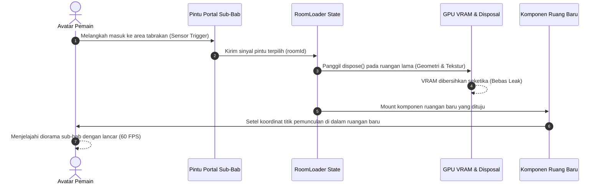

# Dokumentasi Alur Pengguna (User Flow) & Desain Sistem (System Design)
Museum Virtual Universitas Diponegoro (Versi 1.0.0)

Dokumen ini memuat rancangan komprehensif mengenai perjalanan pengguna (*User Flow*) dan arsitektur rekayasa sistem (*System Design*) untuk situs web 3D Museum Virtual Universitas Diponegoro (Undip).

---

## BAGIAN I: ALUR PENGGUNA (USER FLOW)

Alur perjalanan pengguna (*User Journey*) dirancang ramah untuk semua kalangan, mulai dari pengguna umum, mahasiswa baru, hingga penyandang disabilitas (*accessibility-first*).

### 1. Diagram Alur Pengguna Menyeluruh (End-to-End User Flow)

```
[Pengguna Membuka URL Website]
             │
             ▼
   [1. Inisialisasi Sistem]
   ├── Deteksi Profil Perangkat Keras (GPU & RAM)
   ├── Cek Cache Lokal (IndexedDB & Service Worker)
   └── Tentukan Preset Grafis Otomatis (Rendah / Normal / Tinggi)
             │
             ▼
   [2. Layar Sambutan (Splash Gate)]
   ├── Tampilan Judul Megah Museum Virtual Undip
   ├── Peringatan Audio & Tips Navigasi
   └── Tombol Interaktif "Mulai Eksplorasi"
             │ (Klik Pengguna)
             ▼
   [3. Buka Kunci Audio & Sinematik Pembuka]
   ├── AudioContext Resmi Aktif (Mematuhi Autoplay Policy)
   ├── Musik Latar Belakang (BGM) Mulai Mengalun Halus
   ├── Efek Suara (SFX Chime) Berbunyi
   └── Kamera Meluncur Sinematik Menuju Aula Utama Zona 1
             │
             ▼
   [4. Karakter Avatar Muncul (Spawn)]
   ├── Karakter Roblox Low-Poly Berdiri di Titik Awal
   ├── Kamera Pegas Orang Ketiga (Spring Arm Orbit) Mengunci Avatar
   └── Bilah Bawah (Bottom Bar) Menampilkan Panduan Tur (Onboarding Guide)
             │
             ▼
   [5. Navigasi & Eksplorasi Bebas]
   ├── Desktop: Tombol WASD / Panah + Gerakan Mouse
   └── Ponsel: Joystick Sentuh Kiri + Usap Layar Kanan
             │
             ├──────────────────────────────────────────────────────┐
             │                                                      │
             ▼                                                      ▼
[A. Masuk Pintu Portal Sub-Bab]                       [B. Buka Bilah Sisi (Sidebar)]
             │                                                      │
             ▼                                                      ▼
[Teleportasi Dinamis (Dynamic Room)]                  [Pilih Zona Lain (Zona 2 / 3)]
├── Unmount Ruang Lama & Bersihkan VRAM               ├── Transisi Kamera Memudar
├── Mount Ruangan Sub-Bab yang Dituju                 └── Karakter Muncul di Aula Baru
└── Karakter Tiba di Ruang Diorama Khusus
             │
             ▼
[C. Interaksi Bingkai Foto / Sejarah]
├── Dekati Objek -> Muncul Indikator: "[E] Buka"
├── Tekan Tombol [E] atau Sentuh Layar
├── Kamera Meluncur Sinematik Membingkai Foto (Lerp Focus)
├── SFX Whoosh / Chime Berbunyi
└── Modal Informasi Terbuka Halus (Spring Transition)
             │
             ▼
[D. Membaca & Aksesibilitas di Modal]
├── Kolom Kiri: Foto Tokoh Tetap Diam (Fixed)
└── Kolom Kanan: Teks Narasi yang Dapat Digulung (Scrollable)
       ├── Tombol Aksesibilitas Atas:
       │   ├── [Dengarkan Narasi (TTS)]: Suara vokal bahasa Indonesia
       │   └── [A- / Normal / A+]: Memperbesar / memperkecil ukuran huruf
       ├── Tabel Ringkasan Parameter Berhuruf Tegak (Non-Italic):
       │   Nama, TTL, Periode Rektor, Fakultas Asal
       └── Narasi Biografi 6-Bagian:
           1. Profil Umum & TTL
           2. Riwayat Pendidikan Formal
           3. Pengalaman Kerja & Jabatan
           4. Inovasi & Gagasan Monumental
           5. Predikat & Gelar Kehormatan
           6. Fasilitas / Gedung / Jalan yang Diabadikan
             │
             ▼
[E. Tutup Modal Informasi]
├── Tekan [ESC] atau Tombol [X]
├── SFX Penutup Berbunyi
└── Kamera Kembali Luwes ke Sudut Pandang Orang Ketiga
```

---

## BAGIAN II: DESAIN SISTEM (SYSTEM DESIGN)

### 1. Arsitektur Tiga Lapisan (Three-Layer Architecture)

```
┌────────────────────────────────────────────────────────────────────────┐
│                   LAPISAN 1: ANTARMUKA DOM (REACT 19)                  │
│  - Layar Sambutan (Splash Gate)       - Bilah Sisi (Sidebar Nav)       │
│  - Bilah Bawah (Bottom Bar Tour)      - Modal Informasi 2 Kolom        │
│  - Kontrol Aksesibilitas (TTS & Zoom) - Menu Pengatur Grafis Real-Time │
└───────────────────────────────────┬────────────────────────────────────┘
                                    │ Data Binding & React State
┌───────────────────────────────────▼────────────────────────────────────┐
│              LAPISAN 2: PENGELOLA STATUS & OPTIMASI (CORE)             │
│  - ZoneManager (Pengelola Alur Zona 1, 2, 3)                           │
│  - RoomLoader (Dynamic Room Mount & Disposal Lifecycle)                │
│  - CentralAssetManager (Antrean Prioritas & Deduplikasi Berkas)        │
│  - StorageManager (IndexedDB Cache Persisten & PWA Service Worker)     │
│  - Procedural SFX Manager (Web Audio API Synthesizer)                  │
│  - Web Speech TTS Controller (SpeechSynthesis Engine id-ID)            │
└───────────────────────────────────┬────────────────────────────────────┘
                                    │ Props & Three Context Bridge
┌───────────────────────────────────▼────────────────────────────────────┐
│             LAPISAN 3: KANVAS 3D WEBGL (REACT THREE FIBER)             │
│  - Rapier Physics World (Simulasi Tabrakan Kapsul RigidBody WASM)      │
│  - Third-Person Follow Camera (Spring Arm Easing & Lerp Target)        │
│  - Model Gedung Muladi Dome (Kompresi Draco WASM ~350 KB)              │
│  - Pintu Gerbang Portal Teleportasi (Billboard Text Kontras Tinggi)    │
│  - Sistem Pencahayaan Museum (Warm Ivory Ambient 0.75 & Dir 1.25)      │
│  - ChunkGrid & Distance Culling (Pemangkas Objek di Luar Pandang)      │
└────────────────────────────────────────────────────────────────────────┘
```

---

### 2. Daur Hidup Pemuatan Ruang Dinamis (Dynamic Room Loading Lifecycle)

Mekanisme ini mencegah lonjakan konsumsi memori grafis (GPU VRAM) yang sering merusak peramban web (*WebGL Context Lost*):



---

### 3. Arsitektur Perlindungan Peladen (Server Protection Strategy)

Beban rendering grafis sepenuhnya dijalankan di komputer/ponsel pengguna (*Client-Side Rendering*). Namun untuk mencegah lonjakan unduhan berkas yang dapat melumpuhkan peladen kampus Undip:

```
                  Ribuan Mahasiswa Mengakses Bersamaan
                                  │
                                  ▼
      ┌────────────────────────────────────────────────────────┐
      │        TINGKAT 1: Klien Lokal (IndexedDB & PWA)        │
      │  Aset 3D dan audio tersimpan di disk pengguna setelah  │
      │  kunjungan pertama -> 0 byte permintaan ke server!     │
      └───────────────────────────┬────────────────────────────┘
                                  │ (Hanya saat kunjungan perdana)
                                  ▼
      ┌────────────────────────────────────────────────────────┐
      │        TINGKAT 2: CDN Tepi Global (Cloudflare Edge)    │
      │  99% permintaan diserap oleh peladen cache terdekat;   │
      │  mendukung HTTP/2 Multiplexing & Range Requests.       │
      └───────────────────────────┬────────────────────────────┘
                                  │ (Hanya 1% panggilan lolos)
                                  ▼
      ┌────────────────────────────────────────────────────────┐
      │        TINGKAT 3: Penyimpanan Objek Statis (S3/R2)     │
      │  Berkas biner dilayani terpisah dari server aplikasi,  │
      │  sehingga CPU peladen web kampus Undip tetap aman.     │
      └────────────────────────────────────────────────────────┘
```

---

### 4. Matriks Komponen Berdasarkan Tingkat Grafis

| Klasifikasi | Komponen yang Termasuk | Rendah (*Low*) | Normal | Tinggi (*High*) |
| :--- | :--- | :---: | :---: | :---: |
| **Primer (*Primary*)** | Lantai aula, dinding pembatas, pintu portal, avatar pemain, collider fisika Rapier, modal teks informasi. | **Aktif** | **Aktif** | **Aktif** |
| **Sekunder (*Secondary*)** | Lampu sorot etalase (*spotlights*), bayangan lembut, partikel debu halus. | Nonaktif | **Aktif** | **Aktif** |
| **Tersier (*Tertiary*)** | Efek pendaran (*bloom*), pantulan marmer reflektif, bayangan tajam beresolusi tinggi (2048x2048). | Nonaktif | Nonaktif | **Aktif** |
| **Rasio Piksel (*DPR*)** | Ketajaman resolusi kanvas grafis | `1.0` | `1.5` | `2.0` |

---

### 5. Arsitektur Aksesibilitas Suara & Efek Interaksi (Audio Engine)

* **Efek Suara Interaksi (*SFX*)**:
  Menggunakan **Web Audio API Sintesis Prosedural** (osilator nada gelombang sinus & segitiga). Beban penyimpanan nol kilobita (0 KB), tidak ada jeda jaringan (*zero latency*), dan mengiringi setiap klik tombol, buka/tutup modal, dan pengubahan font.
* **Narator Suara (*Text-to-Speech / TTS*)**:
  Menggunakan antarmuka **Web Speech Synthesis API** dengan suara berbahasa Indonesia baku (`id-ID`). Mesin ini membaca teks nama tokoh, masa bakti, pendidikan, inovasi, hingga fasilitas yang diabadikan secara alami dan gratis tanpa ketergantungan API pihak ketiga.
